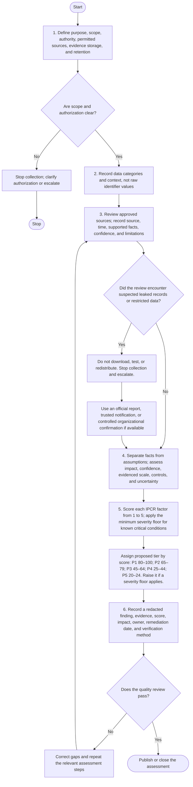

# Methodology

## 1. Overview

This document defines a repeatable workflow for defensive OSINT and personal-data exposure assessment. Use it only for systems, organizations, datasets, or cases for which you have a lawful basis and appropriate authorization. For public incident reporting, rely on reputable reports and avoid independently acquiring exposed records.

The method has six phases:

1. Define scope and authority.
2. Identify data categories and business context.
3. Review approved evidence sources.
4. Assess likely impact and confidence.
5. Prioritize protection using the proposed IPCR score.
6. Document remediation and close the assessment.

## Workflow flowchart

The flowchart follows the six phases below and routes unclear authorization or unsafe evidence encounters to stop and escalation.

## 2. Phase 1: Scope and authorization

Before beginning, document:

- Case or assessment ID.
- Requesting team and accountable owner.
- Objective and business question.
- Systems, domains, organizations, or datasets in scope.
- Written authorization or other approved basis for the activity.
- Permitted sources, collection methods, time window, and exclusions.
- Evidence storage location, access permissions, and retention period.
- Escalation contact for unexpectedly sensitive or exposed material.

Stop if scope or authorization is unclear. Do not expand an investigation from an organization to employees, customers, family members, or other individuals without a separately approved purpose and appropriate basis.

## 3. Phase 2: Categorize the data

Record the category and business purpose, not the raw identifier value. Consider categories such as:

- Civil identity and family records: NIK/KTP, family-card records, civil certificates.
- Tax and financial records: NPWP, bank or payment data, personal financial information.
- Vehicle and transport records: registration plate, STNK, BPKB, SIM-related information.
- Health, biometric, child-related, employment, and education records.
- Contact and digital identity: phone numbers, personal email, addresses, usernames.
- Authentication secrets: passwords, session tokens, API keys, private keys.
- Combinations of attributes that can identify a person when considered together.

Do not assume an identifier is always equally sensitive in every context. A vehicle registration plate, student number, job title, or business identifier may carry different risks depending on whether it can be linked to a particular person and what additional information is exposed.

## 4. Phase 3: Review approved evidence

Prefer sources in this order:

1. Internal asset inventories, data-flow diagrams, and records approved by the data owner.
2. Authorized configuration reviews and approved audit evidence.
3. Official advisories and reputable incident reports.
4. Public domain or certificate metadata relevant to an authorized organizational target.
5. Other sources explicitly approved in the scope.

For each item of evidence, record the source, collection time (use a consistent timezone such as WIB/UTC+7 where useful), what the evidence supports, confidence, and limitations. Keep a URL or reference when safe, but do not paste personal identifiers into public reports.

Do not download, test, or redistribute a suspected leaked dataset merely to confirm that it exists. Use an official report, a trusted third-party notification, or a controlled confirmation from the organization whenever possible. Do not submit sensitive values to public lookup services.

## 5. Phase 4: Assess evidence and impact

Separate facts from assumptions. For each finding, document:

- Data category involved.
- Whether the exposure is confirmed, probable, suspected, or unverified.
- Source and timestamp.
- Potential consequences, such as identity fraud, targeted phishing, account takeover, discrimination, or physical-safety risk.
- Approximate scale, only when supported by reliable evidence.
- Whether other data categories are combined with it.
- Current controls and known gaps.
- Evidence limitations and alternative explanations.

Do not state that a named individual is responsible for fraud or abuse based on an unverified association, username, phone number, or isolated search result.

## 6. Phase 5: Proposed IPCR score

The Indonesia PII Criticality Ranking (IPCR) is a proposed internal prioritization aid created for this project. It is not an official Indonesian classification and should not be represented as one.

Rate each factor from 1 to 5:

| Factor | Weight | Considerations |
|---|---:|---|
| Data sensitivity | 6 | Potential harm if the category is disclosed or misused. |
| Misuse potential | 5 | Likelihood that disclosure could enable fraud, impersonation, account compromise, or other harm. |
| Exposure scale | 4 | Number of people or records potentially affected, based on evidence. |
| Linkability | 3 | Ease of linking the data to a person or combining it with other attributes. |
| Control weakness | 2 | Strength of current access controls, monitoring, and protective measures. |

Formula:

`IPCR = (Sensitivity × 6) + (Misuse Potential × 5) + (Exposure Scale × 4) + (Linkability × 3) + (Control Weakness × 2)`

Minimum possible score: 20. Maximum possible score: 100.

| Score | Proposed tier | Suggested response priority |
|---:|---|---|
| 80–100 | P1: Critical | Immediate escalation and coordinated response. |
| 65–79 | P2: Very High | Urgent action and management visibility. |
| 45–64 | P3: High | Prompt remediation with an assigned owner and deadline. |
| 25–44 | P4: Moderate | Planned remediation and periodic review. |
| 20–24 | P5: Low | Maintain appropriate controls and reassess when context changes. |

### Scoring safeguards

- Document a brief reason for every factor score.
- Use evidence rather than guesses for scale and exposure status.
- Apply a minimum severity floor when a known critical condition exists. For example, exposed active credentials or a confirmed large-scale exposure of highly sensitive records must not be downgraded solely because another factor scores low.
- Treat the score as a prioritization aid, not as a legal classification, breach determination, or guarantee of harm.
- Reassess when new evidence arrives or when data is combined with other attributes.
- Do not use the score to decide whether a legally required notification can be ignored. Consult applicable law, contracts, and incident-response procedures.

## 7. Phase 6: Report and remediate

A finding should include:

- Finding ID and concise title.
- Organization or system in scope (avoid naming affected individuals).
- Data category and exposure status.
- Evidence references and timestamps.
- IPCR factors, score, tier, and rationale.
- Impact and uncertainty.
- Recommended control and responsible owner.
- Target remediation date and verification method.
- Closure status.

Possible mitigations include data minimization, role-based access, encryption, masking, retention limits, secure disposal, improved logging, credential rotation, token revocation, account recovery controls, employee awareness, and coordinated incident handling.

## 8. Quality review

Before publishing or closing a case, confirm that:

- Scope and authorization are recorded.
- Findings are reproducible using safe evidence.
- Sensitive values are absent or irreversibly redacted.
- Claims are supported and uncertainty is disclosed.
- No leaked files or private records are attached.
- Scores follow the documented formula and escalation rules.
- Recommendations have clear owners or actionable next steps.

## 9. Legal and operational references

- Law No. 27 of 2022 on Personal Data Protection: <https://peraturan.bpk.go.id/Details/229798/uu-no-27->
- BSSN official website: <https://www.bssn.go.id/>

This document is educational guidance, not legal advice or a substitute for an authorized security assessment.
