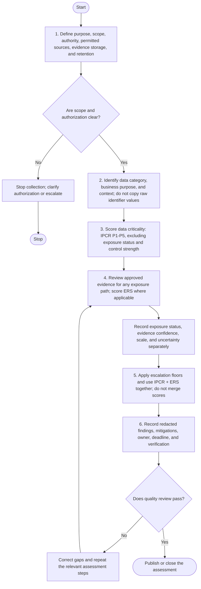

# Methodology

## 1. Overview

This document defines a repeatable workflow for defensive OSINT, data criticality ranking, and personal-data exposure assessment. Use it only for systems, organizations, datasets, or cases for which there is a lawful basis and appropriate authorization. For public incident reporting, rely on reputable reports and avoid independently acquiring exposed records.

The methodology deliberately separates two assessments:

1. **Data criticality (IPCR P1–P5):** potential harm based on the data's sensitivity and context, independent of current exposure status and current security controls.
2. **Exposure risk (ERS ER1–ER5):** seriousness of a known or credibly suspected exposure path, based on evidence, plausible affected scope, accessibility, control gaps, and misuse indicators.

Also record incident status (for example, no indicator found, suspected, probable, confirmed, contained, or remediated) separately from both scores.

## 2. Workflow

1. Define scope and authority.
2. Identify the data categories, purposes, systems, and context.
3. Assign a data criticality score (IPCR) to the defined data category or dataset.
4. Review approved evidence for a specific exposure pathway and assess exposure risk (ERS), if applicable.
5. Apply escalation rules using both dimensions and any required response floors.
6. Document mitigations, owners, due dates, evidence limitations, and verification.

## 3. Workflow flowchart

## 4. Phase 1 — Scope and authorization

Before beginning, document:

- Case or assessment ID.
- Requesting team and accountable owner.
- Objective and business question.
- Systems, domains, organizations, or datasets in scope.
- Written authorization or other approved basis for the activity.
- Permitted sources, collection methods, time window, and exclusions.
- Evidence storage location, access permissions, and retention period.
- Escalation contact for unexpectedly sensitive or exposed material.

Stop if scope or authorization is unclear. Do not expand an investigation from an organization to employees, customers, family members, or other individuals without a separately approved purpose and appropriate basis.

## 5. Phase 2 — Identify and contextualize data

Record data category and purpose—not raw identifier values. Consider civil identity and family records, tax and financial records, vehicle records, health and biometric data, child-related records, employment and education data, contact/digital identity, authentication secrets, and combinations of attributes that can identify a person.

Do not assume an identifier is equally sensitive in every context. A vehicle plate or student number can carry more risk when linked with identity, address, location, or other records.

## 6. Phase 3 — Assess data criticality (IPCR)

Use [`../framework/ipcr-ranking.md`](../framework/ipcr-ranking.md) and [`../framework/scoring-methodology.md`](../framework/scoring-methodology.md).

Rate each factor from 1 to 5:

| Factor | Weight | Meaning |
|---|---:|---|
| Sensitivity (`S`) | 6 | Intrinsic sensitivity in context. |
| Potential harm (`H`) | 6 | Severity of harm if mishandled or misused. |
| Linkability (`L`) | 4 | Ability to identify or profile people from the data and relevant combinations. |
| Vulnerability/context (`V`) | 4 | Whether the subject population or context amplifies harm. |

`IPCR = (S × 6) + (H × 6) + (L × 4) + (V × 4)`

| Score | Level |
|---:|---|
| 80–100 | P1 — Critical |
| 65–79 | P2 — Very High |
| 45–64 | P3 — High |
| 25–44 | P4 — Moderate |
| 20–24 | P5 — Low |

Do not include current control weakness, known exposure status, incident count, or number of records actually exposed in this score. Those belong in the exposure-risk assessment. A high IPCR classification still requires appropriate safeguards even when no exposure is known.

## 7. Phase 4 — Review evidence and assess exposure risk (ERS)

Prefer evidence in this order:

1. Internal asset inventories, data-flow diagrams, logs, and records approved by the data owner.
2. Authorized configuration reviews and approved audit evidence.
3. Official advisories, trusted notifications, and reputable incident reports.
4. Public domain or certificate metadata relevant to an authorized organizational target.
5. Other sources explicitly approved in the scope.

For each item, record the source, timestamp (use a consistent timezone such as WIB/UTC+7 where useful), what it supports, confidence, and limitations. Keep evidence minimal and avoid putting personal identifiers in public reports.

Do not download, test, or redistribute a suspected leaked dataset to confirm it exists. Do not submit sensitive values to public lookup services. Use authorized internal telemetry, a trusted notification, an official report, or controlled confirmation where possible.

When an exposure path is identified or credibly suspected, use [`../framework/exposure-risk-model.md`](../framework/exposure-risk-model.md):

| Factor | Weight | Meaning |
|---|---:|---|
| Exposure evidence/status (`E`) | 6 | Strength of evidence for unauthorized exposure or access. |
| Affected/reachable scope (`N`) | 5 | Records or people plausibly affected or reachable through the issue. |
| Accessibility/exploitability (`A`) | 4 | Ease of unauthorized access through the identified path. |
| Control/containment weakness (`C`) | 3 | Weakness of relevant access, detection, and containment controls. |
| Misuse/persistence indicators (`M`) | 2 | Evidence of attempted or ongoing misuse or continuing access. |

`ERS = (E × 6) + (N × 5) + (A × 4) + (C × 3) + (M × 2)`

| Score | Level |
|---:|---|
| 80–100 | ER1 — Critical |
| 65–79 | ER2 — Very High |
| 45–64 | ER3 — High |
| 25–44 | ER4 — Moderate |
| 20–24 | ER5 — Low |

An ER5 result means no material exposure indicator was identified within the assessment scope; it does not prove that exposure is impossible. Document the scope and visibility limits.

## 8. Phase 5 — Use both scores and incident status

Do not add, average, multiply, or collapse IPCR and ERS into one number.

- IPCR determines baseline data handling and protection expectations.
- ERS supports urgency and response prioritization for a specific exposure path.
- Incident status records whether exposure is not indicated, suspected, probable, confirmed, contained, or remediated.
- Escalation floors apply when active secrets are exposed, sensitive exposure is confirmed, large-scale exfiltration is indicated, or ongoing harm is plausible.

Use [`../framework/risk-escalation-rules.md`](../framework/risk-escalation-rules.md) for minimum response floors and the two-dimensional decision guidance. A score cannot waive applicable legal, contractual, or regulatory obligations.

## 9. Phase 6 — Report and remediate

A finding should include:

- Finding ID and concise title.
- Organization or system in scope (avoid naming affected individuals).
- Data category and purpose.
- IPCR score, level, factor rationale, and required controls.
- Exposure status and, where applicable, ERS score, level, factor rationale, and evidence limitations.
- Potential impact, uncertainty, and affected/reachable scope where reliably known.
- Recommended control and responsible owner.
- Target remediation date and verification method.
- Closure status and reviewer.

Mitigations can include minimization, role-based access, encryption, masking, retention limits, secure disposal, logging, credential rotation, token revocation, account recovery controls, employee awareness, and coordinated incident handling.

## 10. Quality review

Before publishing or closing a case, confirm that:

- Scope and authorization are recorded.
- IPCR excludes exposure status, control weakness, and incident scale.
- ERS factors are based on evidence and describe a specific exposure path.
- Incident status is recorded separately from both scores.
- Any override has a reason, owner, date, and next action.
- Sensitive values are absent or irreversibly redacted.
- No leaked files or private records are attached.
- Recommendations have clear owners and verification steps.

## 11. Legal and operational references

- Indonesia, Law No. 27 of 2022 on Personal Data Protection: <https://peraturan.bpk.go.id/Details/229798/uu-no-27->
- Badan Siber dan Sandi Negara (BSSN): <https://www.bssn.go.id/>

This document is educational guidance, not legal advice or a substitute for an authorized security assessment.
